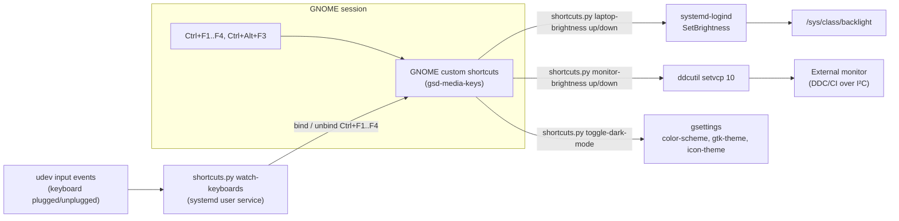

# Ubuntu Port Guide

How to get the hotkeys from `brightness_control.ahk` working on Ubuntu.

Target: **Ubuntu 26.04 LTS** with the default GNOME **Wayland** session.
Ubuntu 24.04 LTS (also GNOME on Wayland by default) works the same way.

## What gets ported

| Key | Action | Ubuntu implementation | Status |
|-----|--------|-----------------------|--------|
| Ctrl+F1 | Laptop screen brightness −25 | sysfs backlight, set through systemd-logind | ✅ |
| Ctrl+F2 | Laptop screen brightness +25 | same | ✅ |
| Ctrl+F3 | External monitor brightness −25 | DDC/CI via `ddcutil` | ✅ |
| Ctrl+F4 | External monitor brightness +25 | same | ✅ |
| Ctrl+Alt+F3 | Toggle system dark/light mode | GNOME `color-scheme` + Yaru theme | ✅ |
| Ctrl+F11 | Connect/disconnect Bluetooth headphones | | **TODO** |

As on Windows, Ctrl+F1–F4 only act while an **external keyboard** is
attached. Without one, the keys pass through unchanged to the focused app.

## How it works

Everything lives in one stdlib-only Python script, `linux/shortcuts.py`, with
one subcommand per action.



**Why the watcher?** AutoHotkey intercepts the key, checks for an external
keyboard, and re-sends the key if there is none. On Wayland, an app can't
intercept and re-inject keys like that (that's a deliberate security property
of Wayland). Instead, the watcher listens for keyboard hotplug events and
*binds* Ctrl+F1–F4 as GNOME shortcuts only while an external keyboard is
present. While they are unbound, GNOME never sees them as shortcuts, so they
reach the app untouched. The result is the same behaviour without needing root
or access to raw input devices.

**Why Python?** It's preinstalled on Ubuntu, the script needs no extra Python
packages, and it handles the parts that would be fragile in Bash (parsing
`/proc/bus/input/devices` bitmaps, file locking for rapid key presses, editing
GNOME's list of custom shortcuts without clobbering your existing ones). I
considered input remappers such as `keyd` or `input-remapper`. They can do
true intercept-and-pass-through at the evdev level, but need a root daemon and
still have to call out to scripts for the actual actions. That's more moving
parts for the same result.

### Ctrl+Alt+F3 and virtual terminals

Linux normally uses Ctrl+Alt+F*n* to switch to text console *n*, and on
Wayland GNOME's compositor (mutter) owns those keys. `install` frees
Ctrl+Alt+F3 by clearing mutter's `switch-to-session-3` binding, and
`uninstall` restores it. Ctrl+Alt+F1, F2, F4…F6 keep working.

## Setup

### 1. Get the repository

```bash
git clone https://github.com/Toldry/ToldryKeyboardShortcuts.git ~/ToldryKeyboardShortcuts
cd ~/ToldryKeyboardShortcuts
```

The shortcuts point at the script's absolute path. If you move the folder
later, re-run step 4.

### 2. Install `ddcutil` (external monitor only)

```bash
sudo apt install ddcutil
```

`ddcutil` replaces NirSoft's ControlMyMonitor. It talks to the monitor over the
I²C bus, which needs the `i2c-dev` kernel module and permission to open
`/dev/i2c-*`:

```bash
ls /dev/i2c-*          # Nothing listed? Load the module now and at every boot:
echo i2c-dev | sudo tee /etc/modules-load.d/i2c-dev.conf
sudo modprobe i2c-dev

ddcutil detect         # Should list your monitor without sudo
```

If `ddcutil detect` only works with `sudo`, add yourself to the `i2c` group,
then log out and back in:

```bash
sudo groupadd --system i2c 2>/dev/null; sudo usermod -aG i2c "$USER"
echo 'KERNEL=="i2c-[0-9]*", GROUP="i2c", MODE="0660"' \
  | sudo tee /etc/udev/rules.d/45-ddcutil-i2c.rules
```

As on Windows, DDC/CI must be enabled in the monitor's on-screen menu.

Everything else the script uses (`python3`, `gsettings`, `busctl`, `udevadm`,
`notify-send`) is preinstalled on Ubuntu desktop.

### 3. Check keyboard detection

```bash
python3 linux/shortcuts.py list-keyboards
```

Example output with a USB keyboard plugged in:

```
BUS    FULL KBD  EXTERNAL  NAME
0011   yes       no        AT Translated Set 2 keyboard
0003   yes       yes       Keychron K2
0003   no        no        Keychron K2 Consumer Control
0003   yes       yes       Yubico YubiKey OTP+FIDO+CCID
```

A keyboard counts as external when it reports a full set of letter keys and
sits on the USB or Bluetooth bus. Windows counted "more than one keyboard";
Linux exposes too many keyboard-like devices (power buttons, media-key nodes)
for that to work, hence the stricter test.

Some devices pretend to be keyboards: YubiKeys (they "type" one-time codes),
some gaming mice, some wireless receivers. If one shows up as external, add
part of its name to `ignore_names` in the config file (step 5) and re-check.

### 4. Install the shortcuts

```bash
python3 linux/shortcuts.py install
```

This:

1. writes a default config to `~/.config/toldry-shortcuts/config.ini`,
2. registers five custom shortcuts in **Settings → Keyboard → View and
   Customize Shortcuts → Custom Shortcuts** (your existing custom shortcuts are
   kept),
3. frees Ctrl+Alt+F3 from virtual-terminal switching,
4. installs and starts a systemd user service,
   `toldry-shortcuts-watcher.service`, which runs the keyboard watcher now and
   at every login. It is the equivalent of the Windows Startup-folder shortcut.

Try the keys. Feedback appears as a short GNOME notification banner, the
closest equivalent of the AHK tooltips.

### 5. Configure (optional)

Edit `~/.config/toldry-shortcuts/config.ini`:

| Setting | Default | Meaning |
|---------|---------|---------|
| `[keyboards] external_bus_types` | `0003, 0005` | Buses that count as external (USB, Bluetooth) |
| `[keyboards] ignore_names` | empty | Name fragments to never count as an external keyboard |
| `[brightness] laptop_step_percent` | `25` | Step for Ctrl+F1/F2 |
| `[brightness] monitor_step_percent` | `25` | Step for Ctrl+F3/F4 |
| `[brightness] backlight_device` | auto | Directory name in `/sys/class/backlight` |
| `[brightness] ddcutil_args` | `--display 1` | Which monitor `ddcutil` talks to |
| `[bindings] …` | as in the AHK script | Key for each action, GNOME accelerator syntax |

`ddcutil_args = --display 1` is the first DDC-capable monitor, replacing the
Windows "Primary display" requirement. Changing it to `--bus N` (the bus number
from `ddcutil detect`, as in `/dev/i2c-N`) makes each key press noticeably
faster because `ddcutil` skips monitor detection.

After changing `[bindings]`, re-run `python3 linux/shortcuts.py install`.
Other settings apply on the next key press. For `[keyboards]`, restart the
watcher:

```bash
systemctl --user restart toldry-shortcuts-watcher.service
```

## Everyday use and diagnostics

```bash
python3 linux/shortcuts.py status          # Everything at a glance
python3 linux/shortcuts.py list-keyboards  # Keyboard classification
tail -f ~/.local/state/toldry-shortcuts/shortcuts.log
journalctl --user -u toldry-shortcuts-watcher.service
```

You can also run any action by hand, e.g.
`python3 linux/shortcuts.py monitor-brightness up`.

The log is cleared each time the watcher starts (each login), like
`brightness_control.log` on Windows.

## Differences from the Windows version

- **External monitor brightness** is still tracked by the script rather than
  read back on every press, because DDC/CI reads are slow. Unlike the AHK
  version, which always started at 50%, the first press after login reads the
  monitor's real value, so it starts in sync. If you change brightness with
  the monitor's own buttons, the tracked value drifts until the next login,
  just as on Windows.
- **Laptop brightness never goes fully to 0.** At 0% the script writes the
  lowest non-zero backlight level, because on many laptop panels a raw 0 turns
  the backlight off completely.
- **GNOME's own brightness slider** may not update its position immediately
  after a hotkey press, since the script sets the backlight directly.
- **Dark mode** switches GNOME's `color-scheme` (which GTK4/libadwaita apps,
  Firefox and Chromium follow live) and, if you use Ubuntu's Yaru theme, also
  the legacy GTK3 and icon themes, matching what Settings → Appearance does.
  No broadcast is needed, unlike `WM_SETTINGCHANGE` on Windows.
- **Feedback** is a notification banner instead of a tooltip near the cursor.
  Wayland doesn't let apps place windows at the cursor.
- **Startup status** shows "External KB: Yes/No" in a notification at login.
  The headphones line is omitted until that feature is ported.

## Troubleshooting

### A Ctrl+F1–F4 key does nothing

- `python3 linux/shortcuts.py status` shows whether the brightness shortcuts
  are currently bound (`'<Control>F1'`) or unbound (`''`).
- If they stay unbound with an external keyboard attached, check
  `list-keyboards` and `journalctl --user -u toldry-shortcuts-watcher.service`.

### Laptop brightness: "Can't set laptop brightness"

The script asks systemd-logind to change the backlight, which works without
root for the user of the active session. If that fails, it falls back to
writing `/sys/class/backlight/*/brightness`, which needs permission. The
simplest fix is:

```bash
sudo apt install brightnessctl   # Its udev rule lets the `video` group write it
sudo usermod -aG video "$USER"   # Then log out and back in
```

If you have more than one backlight device (`ls /sys/class/backlight`) and the
wrong one is picked, set `backlight_device` in the config.

### External monitor: "ddcutil failed"

Run `ddcutil detect` and `ddcutil getvcp 10` yourself. Typical causes are DDC/CI
being off in the monitor menu, a missing `i2c-dev` module, or permissions
(see setup step 2). Some docks and USB-C/DisplayPort adapters don't pass DDC/CI
through.

### Ctrl+Alt+F3 switches to a black text console

Re-run `install`, which frees the key again. Ctrl+Alt+F2 (on some setups F1)
takes you back to your desktop. If you'd rather keep console switching, pick
another key, e.g. `dark_mode_toggle = <Super>F3` in the config, then re-run
`install`.

### Other desktops (KDE, Xfce, …)

The action subcommands (`laptop-brightness`, `monitor-brightness`) work on any
desktop. `toggle-dark-mode`, `install` and the watcher are GNOME-specific. On
another desktop, bind its own custom-shortcut feature to the commands, e.g.
`python3 /path/to/linux/shortcuts.py laptop-brightness up`.

## Uninstall

```bash
python3 linux/shortcuts.py uninstall
```

This stops and removes the watcher service, removes the five custom shortcuts
and restores Ctrl+Alt+F3 virtual-terminal switching. Your config and log are
left in place:

```bash
rm -r ~/.config/toldry-shortcuts ~/.local/state/toldry-shortcuts
```

## TODO: Bluetooth headphones (Ctrl+F11)

Not ported yet. The Windows version toggles the `WH-1000XM4` connection by
enabling/disabling its A2DP and Hands-Free services, shows
"Connecting…"/"Disconnecting…", then confirms the new state or times out after
15 s.

## Development

```bash
python3 linux/test_shortcuts.py   # Unit tests for parsing and helpers
```

## References

- GNOME custom shortcuts via gsettings:
  https://help.gnome.org/users/gnome-help/stable/keyboard-shortcuts-set.html
- systemd-logind `SetBrightness`:
  https://www.freedesktop.org/software/systemd/man/latest/org.freedesktop.login1.html
- Kernel backlight sysfs interface (device type preference):
  https://www.kernel.org/doc/Documentation/ABI/stable/sysfs-class-backlight
- `ddcutil` documentation and I²C permissions: https://www.ddcutil.com/
- `/proc/bus/input/devices` and udev's keyboard heuristic:
  https://github.com/systemd/systemd/blob/main/src/udev/udev-builtin-input_id.c
- GNOME `color-scheme` setting:
  https://gitlab.gnome.org/GNOME/gsettings-desktop-schemas/-/blob/master/schemas/org.gnome.desktop.interface.gschema.xml.in
