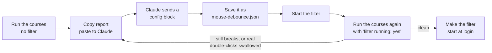
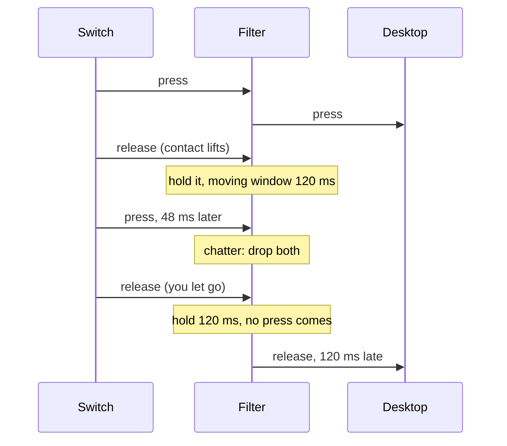

# Mouse chatter calibrator

Your MX Vertical drops drags on Windows too, so the cause is the left
switch itself, not Ubuntu. This kit measures how the switch fails and tunes
a software filter around it. Claude Code does the tuning: you run the
courses, paste the report, and get back a config block.

| File | What it is |
| --- | --- |
| `mouse_courses.html` | The eight obstacle courses. Open it in any browser, on Ubuntu or Windows. The same page is online at https://claude.ai/artifact/5NkLdoM5PzDc8y3pjiCpV5 |
| `mouse_debounce.py` | The filter. One file, runs on Ubuntu (evdev + uinput) and Windows (a low-level mouse hook). Replaces the earlier Ubuntu-only `mouse_debounce.py`; stop that one before starting this. |
| `mouse-debounce.json` | The filter's config, already tuned from your first report. Replace it with each new block Claude sends you. |
| `test_mouse_debounce.py` | Tests for the filter (`python3 -m unittest test_mouse_debounce`). |

## The loop



### 1. Run the courses (5 to 8 minutes)

Open the page, fill in "This session" (connection: Bluetooth or Bolt), and
run courses 1 to 8. Use your normal grip; courses 3 and 4 ask for a lighter
grip on later rounds, because a light grip is what exposes the switch. When a
drag breaks, press again quickly: the course carries on and records the gap.

Courses 6 and 7 (double-click, rapid clicks) matter as much as the drag
courses. They measure your fastest real release-to-press gap, which is the
ceiling for the filter window. Without them Claude can only guess.

### 2. Paste the report to Claude

Press **Copy report** and paste it into Claude Code. It is a few lines of
summary plus one line of JSON with every suspicious gap.

### 3. Save the config and start the filter

Paste the block Claude sends you into `mouse-debounce.json` (next to the
script), replacing what is there. Prose around the braces is tolerated.

Ubuntu:

```bash
sudo apt install python3-evdev
```

```bash
sudo python3 mouse_debounce.py
```

Windows (PowerShell; no admin needed, but see the limits below):

```powershell
winget install Python.Python.3.12
```

```powershell
py mouse_debounce.py
```

Each merged chatter is printed as it happens. Ctrl+C stops the filter and
prints a `MOUSE DEBOUNCE STATS` block; paste that to Claude too, because it
is measured below the browser, straight from the device on Ubuntu.

To measure without changing anything, add `--observe`: the filter reports
what it *would* have done.

```bash
sudo python3 mouse_debounce.py --observe
```

```powershell
py mouse_debounce.py --observe
```

### 4. Check it

Leave the filter running, set "Debounce filter running now?" to "Yes, with
the config loaded below", paste the same config into the page's config box,
and run the courses again. A good config shows no breaks and no swallowed
double-clicks. Paste that report to Claude as well; it closes the loop.

### 5. Make it permanent

Ubuntu, as a systemd service:

```bash
sudo mkdir -p /usr/local/lib/mouse-debounce
sudo cp mouse_debounce.py mouse-debounce.json /usr/local/lib/mouse-debounce/
sudo tee /etc/systemd/system/mouse-debounce.service >/dev/null <<'EOF'
[Unit]
Description=Hide mouse switch chatter

[Service]
ExecStart=/usr/bin/python3 /usr/local/lib/mouse-debounce/mouse_debounce.py --quiet
Restart=on-failure

[Install]
WantedBy=multi-user.target
EOF
sudo systemctl enable --now mouse-debounce
```

The statistics block lands in the journal when the service stops:

```bash
journalctl -u mouse-debounce -n 20
```

Windows, as a task at logon (PowerShell; adjust the folder):

```powershell
$script = "$HOME\mouse-calibrator\mouse_debounce.py"
$action = New-ScheduledTaskAction -Execute "pyw.exe" -Argument "`"$script`" --quiet"
$trigger = New-ScheduledTaskTrigger -AtLogOn -User $env:USERNAME
Register-ScheduledTask -TaskName "Mouse debounce" -Action $action -Trigger $trigger -RunLevel Highest
```

`-RunLevel Highest` lets the filter also cover windows that run as
administrator; without it Windows hides those from the hook.

## How the filter works

At each release of the left button the filter decides which window applies:

- **Moving** (the pointer travelled at least `moving_threshold` since the
  press, so it is a drag): the release is held back for `moving_ms`. If the
  button comes back down inside that window, both events are dropped and the
  drag never notices. Nobody double-clicks mid-drag, so this window can be
  generous.
- **Still** (a click or a long press without moving): `stationary_ms` with
  `stationary_mode`. `hold` works like the moving case and also saves long
  presses, but every click's release arrives that many milliseconds late.
  `block` lets the release through at once and drops a press that follows
  too soon. It adds no delay but only stops ghost double-clicks.
  `confirm` is for hands that double-click as fast as the switch chatters:
  a press inside the window is put on probation. Let go within
  `confirm_ms` and it was a real click, so both clicks are delivered (a
  little late, still well inside the system's double-click time). Held
  longer, or moved, and it was the hold going on, so the gap is merged. A
  press shorter than `bounce_ms` is contact bounce and is dropped.
- The still window must stay below your fastest real double-click gap, or
  double-clicks turn into single clicks. The page measures both sides and
  reports a conflict if they overlap, which means software cannot fully
  fix it and the switch should be replaced.



## What other people found, and what it changed here

- The symptom is common on Logitech mice, and the usual verdict is a dying
  switch. On Tom's Hardware a G300S "releases the left button and then
  presses it again automatically" during drags, and replacing the switch
  with an Omron D2FC-F-K fixed the same fault on an M585:
  https://forums.tomshardware.com/threads/left-mouse-button-release-issue.3690436
  An MX Master 3S thread reports drags working "1 in about 4 tries":
  https://pol1.lr.ggtyler.dev/r/logitech/comments/13blz04/mx_master_3s_left_click_holddrag_problem/jjbpoop/?context=3
  A KDE user had the same drag failure in Dolphin and Firefox and found it
  was the mouse: https://discuss.kde.org/t/how-to-fix-drag-drop-stopping-before-i-release-left-click/43934
- Folk remedies in those threads: press harder (it works until it does not:
  https://forum.3dconnexion.com/viewtopic.php?p=124692), or switch the mouse
  off and click the left button a few dozen times, which people say helps
  "for a few weeks". I am about 60% confident the clicking works by scraping
  the oxide off the contacts; either way it is free to try.
- Most Windows fixes only block a press that comes too soon after a release
  (Mouse-Debouncer, default 60 ms or 50 ms in a fork). That stops ghost
  double-clicks but cannot save a drag: the release has already gone
  through. One fork's README says so outright, "there's no software solution
  for this": https://github.com/marvinlehmann/Mouse-Debouncer and
  https://github.com/1aTa/Mouse-Debouncer. Holding the release back does
  save drags (ClickFix does this, at the cost of "a slight lag":
  https://github.com/CemraJC/clickfix). So the filter holds releases during
  drags and offers `block` mode for clicks, where lag matters more.
- ClickFix warns that too strong a setting breaks double-clicking. That is
  why courses 6 and 7 exist and why the suggestion stays below your fastest
  real gap.
- intercept-bounce (a Linux keyboard filter) advises measuring with a small
  window first, then setting it "slightly higher", and counts near misses:
  https://docs.rs/crate/intercept-bounce/latest/source/README.md
  Here, `--observe` measures, the stats list near misses (gaps just above
  the window), and the page suggests the largest chatter gap × 1.25 plus a
  margin.
- libinput already filters bounces, but only very short ones (its own docs:
  https://wayland.freedesktop.org/libinput/doc/1.9.0/button_debouncing.html).
  Your earlier evtest capture showed 46-52 ms, far outside that.
- Wireless dropouts can look the same. The report checks whether the mouse
  kept sending motion during each break: if it did, the radio link was up
  and the switch is to blame.

The permanent fix is still the switch. iFixit has a guide for this exact
mouse: https://documents.cdn.ifixit.com/pdf/ifixit/guide_138168_en.pdf

## Limits

- The page sees events after the OS. On Ubuntu that includes libinput's own
  short debounce, and on both systems it includes the filter when it runs.
  That is what you want for checking the result. For raw device timing on
  Ubuntu use `--observe`.
- Browser timestamps are good to about 0.1 ms in Chrome and 1 ms in Firefox,
  plenty for gaps of tens of milliseconds.
- The Windows half of the filter has not run on real Windows yet. Its
  decision logic is the same code that the tests cover, but the hook and
  SendInput plumbing is untested. If it misbehaves, Ctrl+C restores normal
  input at once, and a stuck button clears with one click.
- The Ubuntu half was tested against a stand-in for python-evdev, not the
  real device.
- Windows drops a low-level hook that takes too long to answer, without
  telling anyone. If the filter suddenly stops helping, restart it.
- On Windows the filter ignores pen and touch input, so the Duo's screens
  and pen are untouched.
